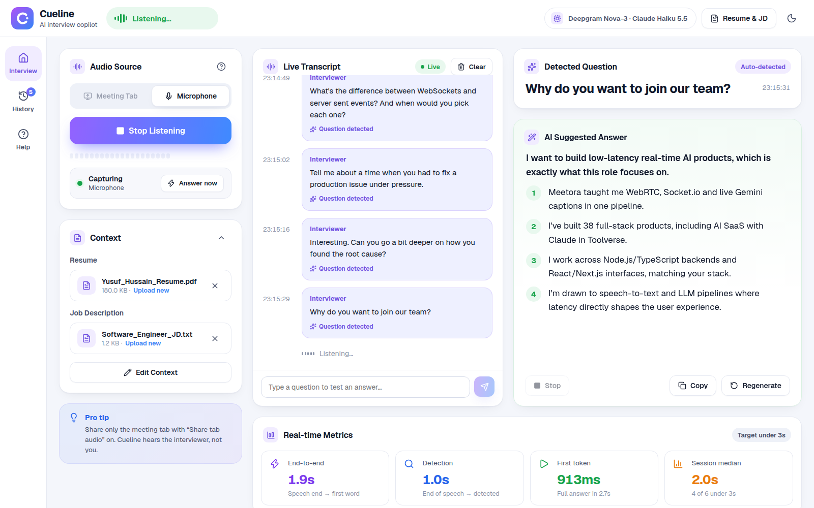
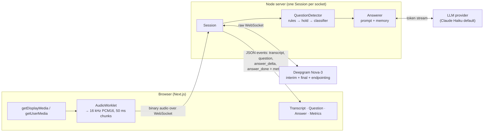
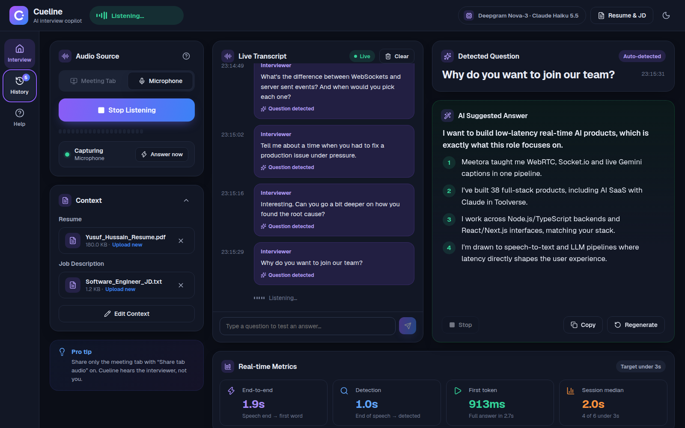
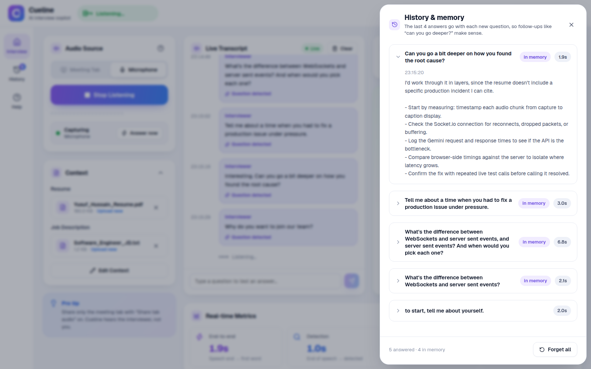
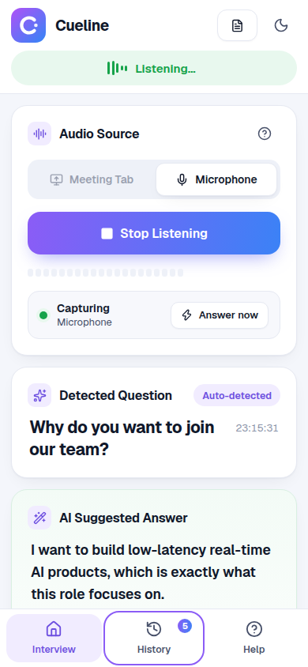

# Cueline: real-time interview copilot

Cueline listens to the interviewer in a Google Meet or Zoom tab, transcribes them live, works out when a question has actually been asked, and streams back a short, speakable answer grounded in your resume and the job description. In the included test run the first answer word appears about **2 seconds** after the interviewer stops talking (median).



```
Audio in ─▶ Speech-to-text (streaming) ─▶ Question detection ─▶ LLM answer (streaming) ─▶ UI
```

| | |
|---|---|
| **Stack** | Next.js 16 + React 19 (web) · Node.js 24 + TypeScript + `ws` (server) · shared TypeScript protocol |
| **Speech-to-text** | Deepgram Nova-3, streaming over WebSocket, interim and final results |
| **LLM** | Claude Haiku 5.5 by default; Groq, OpenAI, Gemini and DeepSeek supported (one env var) |
| **Nice-to-haves (2)** | Latency metrics in the UI · conversation memory for follow-ups |
| **Tests** | 29 unit tests for detection, prompts and parsing · a headless end-to-end simulator · an LLM latency benchmark |

---

## Contents

1. [Setup and run](#setup-and-run)
2. [How it works](#how-it-works)
3. [Key decisions and trade-offs](#key-decisions-and-trade-offs)
4. [Latency](#latency)
5. [Testing](#testing)
6. [Project structure](#project-structure)
7. [Known limitations](#known-limitations)
8. [What I'd build next with another week](#what-id-build-next-with-another-week)
9. [Production risks](docs/production-risks.md)

---

## Setup and run

**Prerequisites:** Node.js **22.18 or newer** (the server runs TypeScript natively, no build step), npm, and Chrome or Edge (needed for tab audio).

```bash
git clone <this repo> cueline && cd cueline
npm install
cp .env.example .env
```

Fill in two keys in `.env`:

| Key | Where to get it | Free tier |
|---|---|---|
| `DEEPGRAM_API_KEY` | [console.deepgram.com](https://console.deepgram.com) → API Keys → Create a New API Key | $200 credit, no card |
| One LLM key: `ANTHROPIC_API_KEY`, `GROQ_API_KEY`, `OPENAI_API_KEY`, `GEMINI_API_KEY` or `DEEPSEEK_API_KEY` | links in `.env.example` | Groq and Gemini have free tiers |

With `LLM_PROVIDER` empty, the first provider that has a key is used, fastest first.

```bash
npm run dev          # server on :8787 and web on :3000
```

Open **http://localhost:3000** in Chrome, then:

1. Click **Resume & JD** and paste your resume and the job description, or upload a PDF/TXT. You can also use **Use sample**.
2. Press **Start Listening**. Pick the meeting tab in the share dialog and keep **Share tab audio** on, or switch to **Microphone**.
3. Ask a question in the meeting. The transcript, detected question and streamed answer appear on the right.

No meeting handy? Type a question under the transcript, or play the bundled mock interview (see [Testing](#testing)).

Production mode: `npm run build && npm start`.

If a key is missing the server still starts, and the page shows a banner naming exactly which key is needed. The server restarts on its own when `.env` changes.

---

## How it works



1. **Capture** (`web/src/lib/audio.ts`). Tab audio comes from `getDisplayMedia` (the video track is dropped immediately), with the microphone as a fallback. An AudioWorklet averages the audio down to 16 kHz, converts it to 16-bit PCM and posts 50 ms chunks, which go over the WebSocket as binary frames. If the network falls behind, audio is dropped rather than queued, because stale audio is worthless. The worklet is adapted from the live-caption pipeline in my earlier video-calling app, Meetora.
2. **Speech-to-text** (`server/src/stt/deepgram.ts`). The server forwards audio to Deepgram's live WebSocket, buffering while the socket opens and sending `KeepAlive`. If the connection drops mid-call, it reconnects without losing the audio clock.
3. **Question detection** (`server/src/detect/`). Final transcript segments are assembled into interviewer turns, and each turn is judged as explained [below](#question-detection).
4. **Answer** (`server/src/answer/`). The question, the resume, the job description and the last few Q&A pairs go to the LLM. Tokens stream back to the browser as `answer_delta` events. A newer question cancels the answer in progress.
5. **UI** (`web/src/components/`). A pure reducer turns server events into the screen: a status pill (listening / thinking / answering), one transcript bubble per turn showing the detector's verdict, the detected question, a numbered streaming answer (Stop / Copy / Regenerate) and latency cards.

The whole client/server contract is one typed file: [`shared/src/protocol.ts`](shared/src/protocol.ts).

---

## Key decisions and trade-offs

### Why Deepgram for speech-to-text

- **It streams.** Deepgram accepts audio over a WebSocket and returns interim results, which change as it hears more, and final results. The live transcript needs exactly that. Whisper, by contrast, is batch-first: streaming it means chunking audio myself and paying for repeated work.
- **It gives end-of-speech signals for free.** `speech_final` fires after a configurable silence (`ENDPOINTING_MS=500`), `UtteranceEnd` is a word-gap backup that still works with background noise, and `SpeechStarted` is a voice-activity event. Question detection is built on these.
- **Accuracy and price.** Nova-3 handles technical vocabulary well ("WebSockets", "Next.js", "Kubernetes"), and new accounts get $200 of credit with no card.
- **Raw WebSocket, no SDK.** The protocol is small (one URL with query parameters, JSON results, three control messages). Writing it directly keeps every byte visible and removes a dependency whose API changes between major versions.
- **Trade-off:** it's a paid dependency in production, and one vendor's latency becomes ours. The `SttStream` interface (`server/src/stt/types.ts`) keeps the rest of the server provider-neutral, so swapping in AssemblyAI or a self-hosted model means writing one file.

### Why Claude Haiku as the default LLM, and why it's pluggable

I measured instead of guessing. `npm run bench:llm` sends five interview questions through the real answer prompt and records time to first token:

| Model | Median TTFT | Min / max | Fits the 3 s target? |
|---|---|---|---|
| **Claude Haiku 5.5** | **747 ms** | 601 / 950 ms | ✅ comfortably |
| GPT-4.1 mini | 1,422 ms | 1,059 / 1,523 ms | ⚠️ tight once detection (~1.1 s) is added |
| Claude Opus 5.5 (low effort) | 5,303 ms | 3,846 / 8,620 ms | ❌ |

Detection takes about 1.1 s, so the LLM has under 2 s to start talking. Haiku is the only model that leaves real headroom. Opus writes richer answers but can't meet the target, so it's one env var away (`ANTHROPIC_MODEL=claude-opus-5-5`) for anyone who prefers quality over speed.

All providers implement one small `LlmClient` interface. Groq, OpenAI and DeepSeek share an OpenAI-compatible adapter, while Claude and Gemini have native ones. The Claude adapter streams at `effort: "low"`, runs the classifier on Haiku with thinking off, and turns on server-side refusal fallbacks, so a live interview never ends with no answer.

### Question detection

The hard part is answering at the right moment: not on "can you hear me?", not halfway through "tell me about a time when…", and not seconds late. I used **layers that get more expensive only when they need to**:

| Layer | When | Cost |
|---|---|---|
| **1. Rules** (`heuristics.ts`) | Every turn | ~0 ms |
| **2. Hold** | The turn trails off on "when / and / the / to…" | Waits up to 1.4 s for the rest |
| **3. LLM classifier** | Rules can't decide (e.g. "how did you handle the migration", unpunctuated) | ~300–600 ms, 1.2 s hard timeout |
| **4. Stable-interim backstop** | Interim text hasn't changed for 900 ms and is a clear, punctuated question | Saves seconds when the STT is slow to finalize |

- **Rules.** Strip fillers ("um", "so, okay"). Drop sentences that are small talk ("hi", "can you hear me okay?", "great, thanks", "let's get started"). Then score what's left: a trailing `?` (+3, since Deepgram punctuates), question words (+2), "can/could/would you…" openers (+2) and interview prompts with no question mark, like "walk me through", "tell me about" or "I'd love to hear about" (+3). A score of 3 or more is answered immediately.
- **Hold for unfinished turns.** A short pause mid-question produces an end-of-speech signal, so a turn ending on a conjunction, article or "to" waits briefly. If the interviewer keeps going, the parts are joined. If not, the turn is judged as it is.
- **Classifier as a tiebreaker, never a bottleneck.** It only runs on ambiguous turns, on the small model, and has a hard timeout with a fallback to the rule score. If the interviewer starts talking again while it runs, the result is thrown away.
- **Backstop for a lagging STT.** The simulator's `--verbose` timeline caught Deepgram re-sending the same unchanged interim ("pick each one?") for about 4 s before finalizing. Now, if interim text is stable for 900 ms and is clearly a finished question, Cueline answers. Late finals are then matched word by word against what was already answered: repeats are ignored, and new words re-ask the whole question (the new answer replaces the early one).
- **Noise handling.** Repeated questions aren't answered twice. A statement just before a question ("we're migrating to Kafka") goes to the LLM as context. A quick "…and when would you use each?" is merged into the previous question. **Answer now** forces an answer for anything detection misses.

Trade-offs: rules are English-only and tuned by hand. The 500 ms endpointing is a compromise between cutting people off and responding late. The backstop occasionally answers a question that then continues, which costs one extra LLM call.

### Prompt design

The system prompt ([`server/src/answer/prompts.ts`](server/src/answer/prompts.ts)) is ordered by priority:

1. **Grounded.** It may mention only employers, projects, numbers and skills found in the `<resume>`. When the resume has nothing relevant, it must say so ("I haven't used X in production, but…") and bridge to real experience. In the test run, asked about a production incident the resume doesn't mention, it answered *"I don't have a documented production incident to share, but I can tell you how I handled real-time issues while building Meetora"* instead of inventing one ([screenshot](docs/screenshots/streaming.png)).
2. **Speakable.** One opening sentence, 3–5 bullets of at most 15 words each, 60–90 words, first person. `max_tokens` backs this up.
3. **Shaped by question type without a separate classifier.** Technical questions get the concept first. Behavioural ones get compressed STAR using a real resume item. "Why this role?" maps resume strengths to the JD. Salary questions get a template with `[placeholders]`.
4. **Injection-safe.** The resume and JD are wrapped in tags and declared as data, never instructions.
5. **Memory.** Earlier Q&A pairs are replayed as real conversation turns, so "can you go deeper on that?" resolves naturally. Only finished answers are remembered.

### Nice-to-haves (picked 2)

- **Latency metrics.** For every answer the server measures *detection* (end of speech → question detected), *first token* (detected → first LLM token), *end-to-end* (end of speech → first token, the number the 3 s target is about) and *full answer*. The UI shows them with a session median and a count of answers under 3 s. End of speech comes from Deepgram's word timestamps, mapped to wall-clock time against the newest audio chunk so jitter early in the call doesn't skew it.
- **Conversation memory.** The last `MEMORY_TURNS` (default 4) finished Q&A pairs go with each question. The History drawer shows which answers are in memory and can clear them.

Basic error handling and reconnect logic also exist, as part of normal robustness rather than as a claimed extra: client reconnect with backoff while idle, Deepgram reconnect mid-call, typed and readable errors, zod-validated messages, payload and rate limits, and a heartbeat.

---

## Latency

The budget from the end of the interviewer's speech to the first answer word, measured with `npm run simulate` on the bundled 71 s mock interview (5 questions, Claude Haiku 5.5):

| Stage | Typical | Notes |
|---|---|---|
| Deepgram endpointing + finalization | ~1.0–1.4 s | 500 ms of silence, plus finalization |
| Detection rules | < 1 ms | the classifier path adds ~0.3–0.6 s, rarely needed |
| LLM time to first token | ~0.7–1.1 s | Haiku |
| **End-to-end** | **median ≈ 2.0–2.3 s** | 4 of 5 under 3 s in each run |

The misses come from tail latency in the providers, not from the pipeline: one Haiku first token took 3.3 s, and on one phrase Deepgram finalized about 2.5 s after the words were spoken. The metric adds roughly 50–100 ms of client capture and upload that it can't see, because it measures from when the server receives the audio. How I'd tighten this further is under [next week](#what-id-build-next-with-another-week).

---

## Testing

```bash
npm test                      # 29 unit tests (node:test): heuristics, detector timing, prompts
npm run make-audio            # builds a mock interview WAV with Deepgram text-to-speech
npm run simulate              # streams it into the running server in real time, like the browser
npm run simulate -- --verbose # also prints the interim transcript timeline
npm run bench:llm -- anthropic:claude-haiku-5-5 openai:gpt-4.1-mini   # TTFT benchmark
npm run lint && npm run typecheck
```

The mock interview deliberately includes small talk, an acknowledgement, a question with a mid-sentence pause, and a follow-up that needs memory. Sample `simulate` output:

```
  4.6s  skipped   (small talk)
 10.8s  QUESTION  [heuristic] to start, tell me about yourself.
 12.7s  ANSWER    e2e 2027 ms · detect 1120 ms · ttft 907 ms · 88 words
 21.1s  skipped   (small talk)
 39.5s  waiting   sounds unfinished
 42.8s  QUESTION  [heuristic] Tell me about a time when you had to fix a production issue under pressure.
 45.3s  ANSWER    e2e 2814 ms · detect 1058 ms · ttft 1756 ms · 72 words
 55.5s  QUESTION  [heuristic] Can you go a bit deeper on how you found the root cause?
 57.2s  ANSWER    e2e 1960 ms · detect 1114 ms · ttft 846 ms · 71 words
```

I also ran the real browser flow with Playwright, feeding the same WAV into Chrome as a fake microphone. It went from Start Listening to all questions answered in the UI with no console errors. That is how the screenshots below were taken.

| Dark theme | History & memory | Phone (390 px) |
|---|---|---|
|  |  |  |

---

## Project structure

```
cueline/
├── shared/src/                 # the WebSocket contract, used by both sides
│   ├── protocol.ts             #   client ↔ server message types
│   └── audio.ts                #   sample rate, chunk size, limits
├── server/
│   ├── src/
│   │   ├── index.ts            # HTTP /health + WebSocket server, origin check, heartbeat
│   │   ├── session.ts          # per-connection pipeline, state machine, latency metrics
│   │   ├── config.ts           # .env validation (zod), provider selection
│   │   ├── stt/                # SttStream interface + Deepgram live client
│   │   ├── detect/             # heuristics.ts (rules) + detector.ts (turns, hold, classifier, backstop)
│   │   ├── answer/             # prompts.ts + answerer.ts (streaming, memory)
│   │   └── llm/                # LlmClient interface: anthropic, openai-compatible, gemini
│   ├── test/                   # node:test unit tests
│   └── scripts/                # simulate, make-test-audio, bench-llm
└── web/src/
    ├── app/                    # layout, page, design tokens (globals.css)
    ├── lib/                    # audio capture, session hook + reducer, context store, PDF text
    └── components/             # top bar, rail, audio, context, transcript, answer, metrics, drawers
```

Each concern lives in its own module (capture, STT, detection, LLM, UI) and talks to the others through one small interface.

---

## Known limitations

- **Tab audio needs Chrome or Edge.** Firefox and Safari can't share tab audio, so they fall back to the microphone.
- **No speaker separation in microphone mode.** The mic hears the candidate too, so their own speech can be judged as a question. Tab mode avoids this because the meeting doesn't play your own voice back.
- **Provider tail latency.** Occasional slow finals from Deepgram and slow first tokens from the LLM push a minority of answers past 3 s (see [Latency](#latency)).
- **Early answers can be replaced.** When the backstop answers and the interviewer turns out to be mid-sentence, the answer is regenerated, at the cost of one extra LLM call.
- **English-only rules.** Detection rules and small-talk lists are English, and STT is set to `en`.
- **Single process, in-memory state.** Sessions and memory live in the server process, with no persistence or horizontal scaling (no database, by design for a POC).
- **The resume stays in the browser.** It's saved in localStorage and sent to the LLM provider with each question. There's no auth (out of scope).
- **Hand-tuned thresholds.** Hold time, stability window and endpointing are tuned on a small set of recordings, not a proper evaluation set.

---

## What I'd build next with another week

1. **Speculative generation.** Start the LLM on a stable interim transcript before the turn is confirmed, and cancel if the words change. That hides most of the 1 s endpointing and should bring the median under 1.5 s.
2. **An evaluation set.** Twenty recorded mock interviews with labelled question boundaries, to measure detection precision and recall plus an LLM-judged groundedness score, and to tune thresholds against numbers instead of feel.
3. **Speaker separation.** Capture tab and mic as two streams, or use Deepgram diarization, so the candidate's own speech is never treated as a question.
4. **Prompt caching.** Cache the resume and JD part of the prompt with Anthropic prompt caching, to cut time to first token and cost on long sessions.
5. **Answer modes and question types.** Concise, detailed and STAR modes, with a per-type prompt. These are the two nice-to-haves I didn't pick.
6. **Provider failover.** Hedged requests: if the primary LLM hasn't produced a token within ~1.2 s, race a second provider.
7. **Production basics.** Docker, auth, per-user rate limits and cost caps, OpenTelemetry tracing across the pipeline, and a load test.

---

Built by **Yusuf Hussain** · [github.com/Yusuf-Hussain25](https://github.com/Yusuf-Hussain25)
